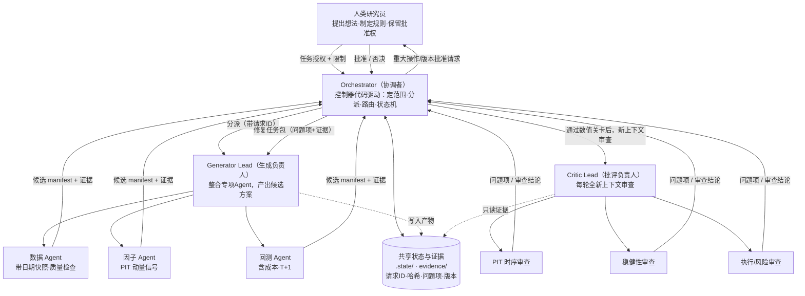
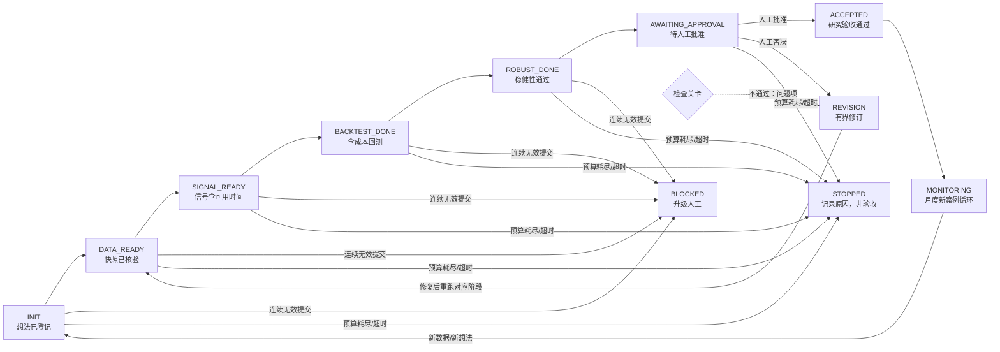

# 架构设计说明：A 股月度截面动量策略长程工作流

> 文档版本：v0.1
> 对应期末作业第 2 部分：运用课程概念设计系统架构
> 配套图：本文内嵌两张带注释 Mermaid 图（角色协作图、状态机图）

## 1. 设计原则

1. **决策与执行分离**：智能体负责"判断下一步做什么"，Harness/控制器负责"核验并真正执行状态转换"。
2. **生成与核验分离**：Generator 不能自我验收，Critic 在全新上下文中独立检查。
3. **确定性计算下沉**：所有数值由 Python 代码计算，结果可复现、可哈希、可重放。
4. **人类保留批准权**：重大操作、版本启用、资金使用必须经人工批准。
5. **默认安全**：权限最小化、预算有上限、失败默认阻断而非放行。

## 2. 总体架构与角色协作（带注释工作流图 1）

注释要点：实线为角色间正式交接；虚线为对共享状态的读写。所有交接都携带 `request_id`，过期或缺失 ID 的提交会被控制器拒绝。

## 3. 角色与交接

| 角色 | 职责 | 可用工具/技能 | 输入 | 输出产物 | 写入权限 |
|---|---|---|---|---|---|
| Orchestrator | 定范围、分派、路由、维护状态机 | 控制器脚本、只读检查 | 任务授权、当前状态、证据 | request.json、decision.json | 仅 `.state/` |
| Generator Lead | 整合专项结果 | Read/Glob/Grep/Write/Bash、Agent | 约束+问题项 | 候选 manifest | `output/`、`temp/` |
| 数据 Agent | 数据快照与质量检查 | 数据技能、Python | 股票池、日期范围 | data/raw 快照+哈希 | `data/` |
| 因子 Agent | 计算 PIT 动量信号 | Python | 数据快照 | 信号表（含可用时间） | `data/processed/` |
| 回测 Agent | 回测、成本、交易记录 | Python | 快照+信号 | 净值、交易、指标 | `output/` |
| Critic Lead | 独立审查、汇总问题项 | 只读工具、新上下文 | 候选证据+固定标准 | 问题项+结论 | `evidence/` |
| PIT/稳健性/执行审查员 | 专项核验 | 只读、测试运行器 | 对应专项证据 | 专项审查报告 | `evidence/` |

**为什么这样分工**：构建与核验分属不同上下文，避免"自己查自己"；专项 Agent 职责单一、口径一致；只有控制器能更新控制状态，防止智能体自行跳过流程。

**智能体决策 vs Harness 执行**：智能体可以说"我建议进入回测"，但只有控制器脚本核验前置产物齐全、检查关卡通过后，才真正把状态推进到下一阶段；否则提交被否决，状态不变。

## 4. 状态机与条件路由（带注释工作流图 2）

| 状态 | 含义 | 进入条件 |
|---|---|---|
| INIT | 想法、参数、验收标准已登记 | idea.json 完整 |
| DATA_READY | 带日期快照通过质量检查 | 数据 gate 通过、哈希已存 |
| SIGNAL_READY | 信号仅用截至调仓日数据 | PIT 检查通过 |
| BACKTEST_DONE | 信号后交易、扣成本、T+1 | 数值 gate 通过 |
| ROBUST_DONE | 参数/扰动/成本压力测试通过 | 稳健性报告齐全 |
| AWAITING_APPROVAL | 等待人工批准 | 全部 Critic 通过 |
| ACCEPTED | 研究验收（连续两轮审查通过） | 人工批准 |
| REVISION | 按问题项修订 | 任一 gate/Critic 不通过 |
| BLOCKED | 连续无效提交，升级人工 | 第 2 次无效提交 |
| STOPPED | 超时/预算耗尽，记录原因 | 触达上限（≠验收） |

## 5. 长程运行机制

### 5.1 持久化状态与检查点

- `.state/state.json`：当前状态、角色、轮次、重试次数、截止时间、`request_id`。
- `.state/cases/<case>/rounds/round-NNN/`：每轮的 generator 报告、numerical 结果、critic 报告、decision。
- `trace.jsonl`：只追加的事件轨迹；每个数据快照保存文件哈希。
- 原则：**每次状态转换都保存已核验状态；对话最后一行不能证明工作完成。**

### 5.2 触发与调度

- 月度调仓日定时触发；新想法/新数据/数据版本变化事件触发；监测阶段异常触发。
- 输入版本变化时新建案例并重建依赖产物。

### 5.3 重试、停止与升级

- 暂时性错误在固定上限内按指数退避重试；无效证据不得推进。
- 停止结果区分：否决、阻断（BLOCKED）、耗尽（STOPPED）、停滞、用户停止，均记录原因；**耗尽不等于验收通过**。
- 连续两次无效提交即 BLOCKED 并升级人工。

### 5.4 中断恢复（不重复已完成操作）

1. 启动时读取 `state.json`，核验各产物路径与哈希；
2. 已完成且哈希一致的案例直接返回保存结果，不重跑；
3. 状态不确定的外部操作先核对再决定；
4. 只恢复"已核验的待办工作"，并对外部不确定操作做幂等检查。

### 5.5 预算与权限限制

在 `config/limits.json` 设定：最大轮数、最大重试、工具调用次数、总用时、成本上限、可访问目录与网络白名单；超限即停止并升级。控制器在提示词之外强制执行，提示词无法自行放宽。

## 6. 核验与改进

### 6.1 独立检查与检查关卡

- 每个阶段设可执行 gate（数据质量、PIT 时序、数值、成本、限额），由控制器运行，不靠模型自述。
- Critic 在全新上下文审查，减轻锚定效应；问题项写入台账。

### 6.2 人工批准与有界修订

- 重大操作与版本启用前必须人工批准；修订循环次数有上限（见 config）。
- 问题项只有在 Critic 核验修复证据后才能关闭；下一次请求必须携带全部未解决问题项。
- 同一候选策略须**连续两轮**通过完整审查，策略改动后连续计数清零。

### 6.3 基线测试、版本与回滚

- 改动前先固定基线与验收标准；划分开发案例（用于反馈）与留出案例（最终评估）。
- 版本注册表记录每版的模型、工具、数据、规则、提示词与 commit；通过审查才批准启用。
- 改动被否决/暂缓则保留当前版本；回滚恢复旧版本指针，并在新案例核验行为后才生效。

## 7. 防止未来信息泄露（PIT，时序专章）

1. 每个快照带 `as_of`，任何阶段只能用 `as_of <= 调仓日` 的数据；
2. 信号记录"信号可用时间"，**最早允许执行时间 = 信号可用之后**（遵守 T+1）；
3. 专项 PIT 检查：扰动 t 之后的价格，t 时点信号必须不变；
4. 仅有日期字段不充分，必须证明执行时点晚于信号可用时点；
5. 历史成分、停牌、退市按当时真实股票池处理，避免幸存者偏差（合成 fixture 中显式建模）。

## 8. 设计到代码的映射

| 设计概念 | 落地位置 |
|---|---|
| 状态机/控制器 | `src/controller.py`、`src/state_machine.py` |
| 检查关卡 | `src/gates.py`、`scripts/check.py` |
| 数据/信号/回测 | `src/data.py`、`src/signals.py`、`src/backtest.py` |
| 角色提示词 | `prompts/orchestrator.md`、`generator.md`、`critic.md` |
| 可复用技能 | `skills/` |
| 限额/Schema | `config/limits.json`、`config/state_schema.json` |
| 运行状态/证据 | `.state/`、`evidence/` |
